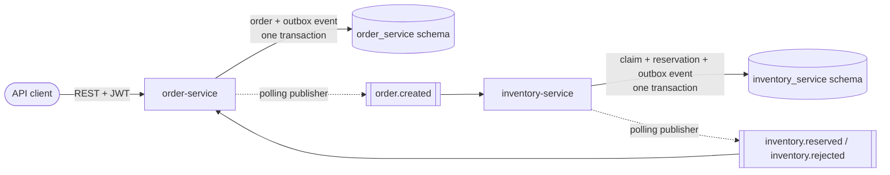
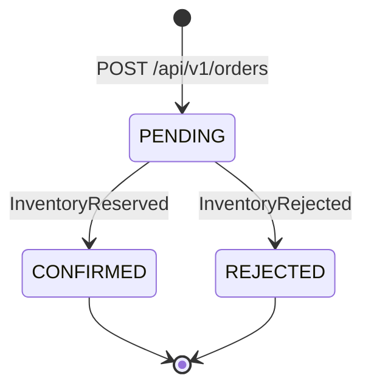

# Resilient Order Pipeline

[](https://github.com/kaulinmindiola/resilient-order-pipeline/actions/workflows/ci.yml)

A reference backend for reliable, event-driven order processing: eventual consistency and fault
tolerance across two services, built on Kafka and PostgreSQL, and proven by tests that break the
system on purpose.

## The problem

Creating an order is a synchronous operation, but what comes after it (reserving stock, confirming
or rejecting the order) happens asynchronously in another service. These steps cannot be wrapped in a
single ACID transaction. The naive approach of "save to the database, then publish to Kafka" is a dual
write: if the process crashes between the two steps, the order exists but the event is lost, and the
order stays in `PENDING` forever.

This project keeps the business flow coherent despite that gap, without distributed transactions.

## What it demonstrates

- **Transactional Outbox** in both services: state changes and outgoing events are persisted in the
  same local transaction and published afterwards by a polling publisher, which marks an event only
  after the broker acknowledged it.
- **Idempotent consumers**: delivery is at-least-once, and duplicates (redeliveries, ambiguous
  timeouts, crashes) produce their business effect exactly once, enforced by a primary key.
- **Retries and Dead Letter Topics**: transient failures are retried with a short backoff (which
  briefly blocks the partition, a deliberate trade-off); invalid messages go straight to a DLT and
  never block subsequent messages.
- **Stock reservation without overselling or deadlocks** under concurrent requests, delegating
  atomicity to the database and rolling back to a savepoint when a reservation is rejected.
- **Recovery from failures**: with Kafka down, orders are still accepted and none is lost; a consumer
  killed with work in flight neither loses nor duplicates anything.
- **Lightweight hexagonal architecture**: the domain depends on no infrastructure, enforced by an
  automated architecture test.
- **Testing against real infrastructure**: PostgreSQL and Kafka via Testcontainers, and black-box
  system tests against the real Docker Compose stack, including failure scenarios.

Every item is backed by a test: see [Evidence](#evidence).

## Architecture



- Two independent Spring Boot services. They share one PostgreSQL instance, but each owns its schema
  and its database role: neither can read the other's tables, and a test proves it.
- They communicate exclusively through Kafka (KRaft mode). PostgreSQL is the source of truth for all
  business state; Kafka is transport only.
- Each service has its own outbox. Consumers record every processed event, so redeliveries are no-ops.
- Failing messages are retried 3 times (1 s, 2 s, 4 s) and then sent to `<topic>.DLT`.

Order lifecycle:



`CONFIRMED` and `REJECTED` are terminal: a late or contradictory event is recorded and ignored, never
treated as an error.

## Quick start

Requirements: Docker with Docker Compose, running. Nothing else: the images build the code.

```powershell
# Windows (PowerShell)
git clone https://github.com/kaulinmindiola/resilient-order-pipeline.git
cd resilient-order-pipeline
Copy-Item .env.example .env
docker compose up --build -d
```

```bash
# Linux / macOS
git clone https://github.com/kaulinmindiola/resilient-order-pipeline.git
cd resilient-order-pipeline
cp .env.example .env
docker compose up --build -d
```

The first build downloads base images and dependencies and can take several minutes. The services are
ready when `docker compose logs order-service` shows `Started OrderServiceApplication`.

Get a token, create an order and read it back:

```powershell
# Windows (PowerShell)
$token = (Invoke-RestMethod -Method Post -Uri http://localhost:8080/auth/token -ContentType "application/json" `
    -Body '{"clientId":"demo-client","clientSecret":"demo-secret-change-me"}').accessToken
$headers = @{ Authorization = "Bearer $token" }
$order = Invoke-RestMethod -Method Post -Uri http://localhost:8080/api/v1/orders -Headers $headers `
    -ContentType "application/json" -Body '{"items":[{"productId":"SKU-001","quantity":2}]}'
Invoke-RestMethod -Uri "http://localhost:8080/api/v1/orders/$($order.orderId)" -Headers $headers
```

```bash
# Linux / macOS (requires jq)
TOKEN=$(curl -s -X POST localhost:8080/auth/token -H 'Content-Type: application/json' \
  -d '{"clientId":"demo-client","clientSecret":"demo-secret-change-me"}' | jq -r .accessToken)
ORDER_ID=$(curl -s -X POST localhost:8080/api/v1/orders -H "Authorization: Bearer $TOKEN" \
  -H 'Content-Type: application/json' -d '{"items":[{"productId":"SKU-001","quantity":2}]}' | jq -r .orderId)
curl -s localhost:8080/api/v1/orders/$ORDER_ID -H "Authorization: Bearer $TOKEN"
```

The order starts `PENDING` and becomes `CONFIRMED` within about ten seconds: run the last command
again. The seeded catalog lets you try every outcome:

| Product | Stock | Result |
|---|---|---|
| `SKU-001` | 1000 | `CONFIRMED` |
| `SKU-002` | 1 | `CONFIRMED` once, then `REJECTED` |
| `SKU-003` | 0 | `REJECTED` (insufficient stock) |
| `SKU-004` | no stock row | `REJECTED` (unknown product in inventory) |
| `SKU-999` | not in the catalog | `422` on creation |

[`docs/requests.http`](docs/requests.http) contains the same requests for IntelliJ's HTTP client.

Stop everything and delete the data with `docker compose down -v`. The stack publishes ports 8080
(API), 5432 (PostgreSQL) and 9094 (Kafka).

### See it survive a Kafka outage

```bash
docker compose pause kafka
# create an order as above: it is accepted (201) and stays PENDING
docker compose unpause kafka
# read it again: within seconds it is CONFIRMED, with no manual action
```

While Kafka is down, the order and its event wait in PostgreSQL. When Kafka returns, the outbox
publisher sends the event and the pipeline completes on its own.

## API

| Endpoint | Auth | Success | Errors |
|---|---|---|---|
| `POST /auth/token` | — | `200` with a Bearer token valid for 30 minutes | `400`, `401` |
| `POST /api/v1/orders` | Bearer | `201` with `orderId` and `Location` header | `400`, `401`, `422` |
| `GET /api/v1/orders/{id}` | Bearer | `200` with status, items and total | `400`, `401`, `404` |

Clients never send prices: they come from the catalog. Every error is an RFC 9457 `ProblemDetail`
and never exposes internal details.

`POST /auth/token` is a deliberately minimal credential exchange, **not OAuth2**: issuing tokens is
custom, while validating them relies on Spring Security's resource server. See the limitations below.

## Evidence

Every claim of this README is backed by a test. Tests marked ★ are the core evidence of the project.
System tests run against the real `docker-compose.yml`, with the images built from source.

| # | What is demonstrated | Test | Requirement / decision |
|---|---|---|---|
| 1 | An order and its outbox event are committed or rolled back together | [`OrderOutboxAtomicityIT`](order-service/src/test/java/io/github/kaulinmindiola/rop/order/application/OrderOutboxAtomicityIT.java) | REQ-FUNC-004, BR-008 |
| 2 | Outbox events reach Kafka keyed by order id, and are marked only after the acknowledgement | [`OutboxPublisherIT`](order-service/src/test/java/io/github/kaulinmindiola/rop/order/adapter/out/kafka/OutboxPublisherIT.java) | REQ-FUNC-010, ADR-0001 |
| 3 | `OrderCreated` leads to `InventoryReserved` or `InventoryRejected` | [`OrderCreatedConsumerIT`](inventory-service/src/test/java/io/github/kaulinmindiola/rop/inventory/adapter/in/kafka/OrderCreatedConsumerIT.java) | REQ-FUNC-012, REQ-FUNC-013 |
| 4 | Inventory outcomes drive the order to `CONFIRMED` or `REJECTED` | [`InventoryOutcomeConsumerIT`](order-service/src/test/java/io/github/kaulinmindiola/rop/order/adapter/in/kafka/InventoryOutcomeConsumerIT.java) | REQ-FUNC-014, REQ-FUNC-015 |
| 5 | The full flow, end to end, through the public API | [`HappyPathSystemIT`](system-tests/src/test/java/io/github/kaulinmindiola/rop/system/HappyPathSystemIT.java) | REQ-FUNC-001..015 |
| 6 | Only a valid, unexpired token signed with our key gets through | [`AuthenticationIT`](order-service/src/test/java/io/github/kaulinmindiola/rop/order/adapter/in/rest/AuthenticationIT.java), [`TokenEndpointIT`](order-service/src/test/java/io/github/kaulinmindiola/rop/order/adapter/in/rest/TokenEndpointIT.java) | REQ-FUNC-007..009, ADR-0005 |
| 7 ★ | With Kafka down, orders are accepted and none is lost; they complete on their own once it returns | [`KafkaOutageSystemIT`](system-tests/src/test/java/io/github/kaulinmindiola/rop/system/KafkaOutageSystemIT.java), [`OutboxKafkaOutageIT`](order-service/src/test/java/io/github/kaulinmindiola/rop/order/adapter/out/kafka/OutboxKafkaOutageIT.java) | REQ-FUNC-011, ADR-0001 |
| 8 ★ | The same event delivered twice has a single effect | [`DuplicateDeliveryIT`](inventory-service/src/test/java/io/github/kaulinmindiola/rop/inventory/adapter/in/kafka/DuplicateDeliveryIT.java) | REQ-FUNC-016, ADR-0011 |
| 9 | A consumer killed with work in flight neither loses nor duplicates any effect | [`ConsumerCrashSystemIT`](system-tests/src/test/java/io/github/kaulinmindiola/rop/system/ConsumerCrashSystemIT.java) | ADR-0011 |
| 10 ★ | A failing message is retried with backoff, then dead-lettered; invalid messages are never retried | [`PoisonMessageIT`](inventory-service/src/test/java/io/github/kaulinmindiola/rop/inventory/adapter/in/kafka/PoisonMessageIT.java) | REQ-REL-001, ADR-0004 |
| 11 ★ | Concurrent reservations never oversell and never deadlock | [`ConcurrentReservationIT`](inventory-service/src/test/java/io/github/kaulinmindiola/rop/inventory/adapter/out/persistence/ConcurrentReservationIT.java) | BR-015, ADR-0010 |
| 12 | An invalid state transition is a recorded no-op, not an error | [`InvalidTransitionIT`](order-service/src/test/java/io/github/kaulinmindiola/rop/order/adapter/in/kafka/InvalidTransitionIT.java) | BR-014, REQ-FUNC-019 |
| 13 | Events of one order land in one partition and are consumed in order | [`PartitionOrderingIT`](order-service/src/test/java/io/github/kaulinmindiola/rop/order/adapter/out/kafka/PartitionOrderingIT.java) | ADR-0003, ADR-0012 |
| 14 | A stock rejection is committed as a result, decrements nothing and is never dead-lettered | [`CommittedRejectionIT`](inventory-service/src/test/java/io/github/kaulinmindiola/rop/inventory/adapter/in/kafka/CommittedRejectionIT.java) | BR-015, ADR-0010 |
| 15 | Each service's database role cannot touch the other service's schema | [`SchemaIsolationIT`](order-service/src/test/java/io/github/kaulinmindiola/rop/order/SchemaIsolationIT.java) | ADR-0002, ADR-0015 |
| 16 | An order can be followed across services in JSON logs, and no secret is ever logged | [`StructuredLogsSystemIT`](system-tests/src/test/java/io/github/kaulinmindiola/rop/system/StructuredLogsSystemIT.java) | REQ-OBS-001, REQ-SEC-002 |
| — | The domain depends on no infrastructure | [`ArchitectureTest` (order)](order-service/src/test/java/io/github/kaulinmindiola/rop/order/ArchitectureTest.java), [`ArchitectureTest` (inventory)](inventory-service/src/test/java/io/github/kaulinmindiola/rop/inventory/ArchitectureTest.java) | REQ-MAINT-001, ADR-0006 |

## Key design decisions

Each decision is recorded as an ADR in [`docs/adr`](docs/adr), with the options considered, the
trade-offs accepted and the tests that confirm it.

| ADR | Decision |
|---|---|
| 0001 | Embedded polling publisher for the outbox: ack, then mark; delivery is at-least-once |
| 0002 · 0015 | One schema and one owner role per service in a single PostgreSQL instance |
| 0003 · 0012 | Partition key = order id; 3 partitions declared at startup, auto-creation disabled |
| 0004 | Retry with exponential backoff, then a Dead Letter Topic; invalid messages are not retried |
| 0005 | Self-issued HS256 tokens validated by Spring Security's resource server; not OAuth2 |
| 0006 | Lightweight hexagonal architecture, enforced by ArchUnit |
| 0010 | Stock reserved with a conditional `UPDATE` in a fixed lock order; rejection rolls back to a savepoint |
| 0011 | A consumer claims the event, applies its effect and writes its outbox in one transaction |
| 0013 · 0016 | Each service has its own outbox; shared code is duplicated deliberately, not put in a library |
| 0018 | JPA only for the order aggregate; `JdbcClient` for technical tables and stock |

## Known limitations

These are deliberate scope decisions for `v0.1.0`, not oversights.

- **An order can stay `PENDING`** if its event ends up in a dead letter topic: there is no
  compensation and no DLT replay. The message is preserved in `<topic>.DLT` for inspection.
- **Reserved stock is never released**: there is no cancellation or reservation expiry.
- **The rejection reason is only logged**, not stored with the order.
- **Publication latency is bounded by the polling interval** (5 s by default), and processed outbox
  rows are never purged.
- **One instance per service**: running several outbox publishers concurrently would require row
  locking (`FOR UPDATE SKIP LOCKED`) or change data capture.
- **One Kafka broker** with replication factor 1: no broker fault tolerance.
- **Authentication is minimal**: no OAuth2, no refresh tokens, no key rotation, no rate limiting on
  `/auth/token`, and no HTTPS.

## Building and testing

Requires JDK 21 and a running Docker engine (integration tests use Testcontainers).

```powershell
.\mvnw.cmd clean verify                                 # Windows (PowerShell)
```

```bash
./mvnw clean verify                                     # Linux / macOS
```

System tests start the real Docker Compose stack, so stop any running stack first:

```powershell
docker compose down
.\mvnw.cmd -Psystem-tests -pl system-tests verify       # Windows (PowerShell)
```

```bash
docker compose down
./mvnw -Psystem-tests -pl system-tests verify           # Linux / macOS
```

CI runs both suites on every push and pull request.

## Project layout

```
order-service/       REST API, order aggregate, outbox, inventory outcome consumer
inventory-service/   OrderCreated consumer, atomic stock reservation, outbox
system-tests/        black-box tests against the real Docker Compose stack
infra/postgres/      init script: one schema and one owner role per service
docs/                requirements, design, ADRs, event contracts, request collection
```

## Documentation

- [Software requirements specification](docs/srs.md): business rules and requirements (`BR-*`, `REQ-*`)
- [Software design description](docs/sdd.md): architecture, data model, flows and configuration
- [Architecture decision records](docs/adr)
- [Event contracts](docs/events.md)
- [Request collection](docs/requests.http)
- [Demo guide](docs/demo.md): a five-minute tour of the failure scenarios

## Tech stack

- **Language:** Java 21
- **Framework:** Spring Boot 4.1 (Spring Framework 7)
- **Build:** Maven (multi-module), with the Maven Wrapper
- **Database:** PostgreSQL 16, with Flyway migrations
- **Messaging:** Apache Kafka 4.2 (KRaft) with Spring Kafka
- **Security:** Spring Security 7 resource server with self-issued JWT (HS256)
- **Logging:** Spring Boot structured logging (JSON) with MDC correlation
- **Testing:** JUnit Jupiter, AssertJ, Testcontainers 2, Awaitility, ArchUnit
- **Environment:** Docker Compose
- **CI:** GitHub Actions, Dependabot

## License

Licensed under the Apache License 2.0. See [LICENSE](LICENSE). All dependencies use permissive or
weak-copyleft licenses.
