# Software Design Description — Resilient Order Pipeline

Version 1.1 · Kaulin Mindiola

## Revision History

| Name | Date | Reason for changes | Version |
|---|---|---|---|
| Kaulin Mindiola | 2026-09-10 | Initial baseline, derived from the SRS and the accepted decisions | 0.1 |
| Kaulin Mindiola | 2026-10-04 | Design baseline before implementation | 1.0 |
| Kaulin Mindiola | 2026-10-11 | Aligned with the implementation of v0.1.0 | 1.1 |

## Table of Contents

- [1. Introduction](#1-introduction)
- [2. Design Overview](#2-design-overview)
- [3. Design Views](#3-design-views)
- [4. Decisions](#4-decisions)
- [5. Security](#5-security)
- [6. Appendixes](#6-appendixes)

## 1. Introduction

### 1.1 Document Purpose

This SDD describes **how** Resilient Order Pipeline v0.1.0 satisfies the requirements in
[`srs.md`](srs.md): its components, interfaces, data, behaviour and deployment. It reflects the system
as implemented. The rationale behind each significant choice lives in the architecture decision
records under [`adr/`](adr/); this document references them rather than repeating them. Its audience is
the author and any technical reviewer evaluating the design.

### 1.2 Subject Scope

Two services, `order-service` and `inventory-service`, collaborate asynchronously through Apache Kafka.
PostgreSQL is the source of truth, with one schema and one owner role per service (ADR-0002, ADR-0015).
Both services use the Transactional Outbox pattern (ADR-0001, ADR-0013) and idempotent consumers
(ADR-0011). The design covers the REST and event contracts, the data model, authentication, failure
handling (Kafka outage, duplicates, retries, dead letter topics) and the Docker Compose deployment.
Everything listed as out of scope in the SRS is excluded.

### 1.3 Definitions

| Term | Definition |
|---|---|
| Adapter | Infrastructure component that implements a port or exposes the application (REST controller, Kafka listener, JDBC repository). |
| Aggregate | See SRS 1.3. In this system, the order. |
| At-least-once | Delivery guarantee: every event is delivered one or more times, never zero. |
| Claim | Recording `(event_id, consumer)` in `processed_events` with `INSERT … ON CONFLICT DO NOTHING`; zero inserted rows means the event was already processed. |
| Consumer group | Kafka consumers sharing the partitions of a topic: `order-service` and `inventory-service`. |
| DLT | Dead letter topic, `<topic>.DLT`. |
| KRaft | Kafka operating mode without ZooKeeper (ADR-0007). |
| MDC | Mapped Diagnostic Context: per-thread fields (`orderId`, `eventId`) added to every log line. |
| Outbox | Table where an outgoing event is stored in the same transaction as the state change that produced it. |
| Partition key | Value that selects the Kafka partition; always the order id (`aggregateId`, ADR-0003). |
| Port | Interface defined by the domain for an external dependency (ADR-0006). |
| ProblemDetail | RFC 9457 error body. |
| Savepoint | Point inside a transaction that can be rolled back to without aborting the transaction. |

### 1.4 References

| Title | Location | Type |
|---|---|---|
| Software Requirements Specification | [`srs.md`](srs.md) | Normative |
| Architecture Decision Records ADR-0001..0018 | [`adr/`](adr/) | Normative |
| Event contracts | [`events.md`](events.md) | Normative |
| RFC 9457 — Problem Details for HTTP APIs | https://www.rfc-editor.org/rfc/rfc9457 | Normative (error format) |

## 2. Design Overview

An event-driven reference backend in which two services reach a consistent outcome without distributed
transactions. The design prioritises: (a) making the reliability patterns verifiable by tests;
(b) keeping the domain independent of messaging and persistence technology (ADR-0006); and
(c) avoiding complexity the scope does not justify (no CQRS, no event sourcing, no saga framework, no
schema registry).

### 2.1 Stakeholder Concerns

| Stakeholder | Concern | Viewpoints |
|---|---|---|
| Implementer | Enough structure to implement and change the system safely | Composition, Logical, Dependency, Interaction |
| Technical reviewer | Coherence between decisions, design and code | Patterns, Decisions, Verification |
| API client | Stable request, response and error contracts | Interface |
| Operator | Start, observe and recover the system | Deployment, Configuration |
| All | Eventual consistency and fault tolerance work as documented | Information, State, Concurrency, Algorithm |

### 2.2 Selected Viewpoints

| Viewpoint | Selected | Reason |
|---|---|---|
| Context, Composition, Logical, Dependency | Yes | One external actor, four deployables, ports and adapters, a dependency rule enforced by a test |
| Information, Interface | Yes | Data ownership per schema; REST and event contracts |
| Interaction, Algorithm, State Dynamics, Concurrency | Yes | The core of an event-driven system: flows, failure paths, idempotency, atomic reservation |
| Patterns, Deployment | Yes | The patterns are the project's purpose; a single-command environment is a requirement |
| Physical, Structure, Resources | No | Single-machine Docker deployment; no internal structure beyond Composition and Logical; no resource contention in scope |

## 3. Design Views

### 3.1 Context

- **ID:** DV-001 · **Title:** System context · **Viewpoint:** Context

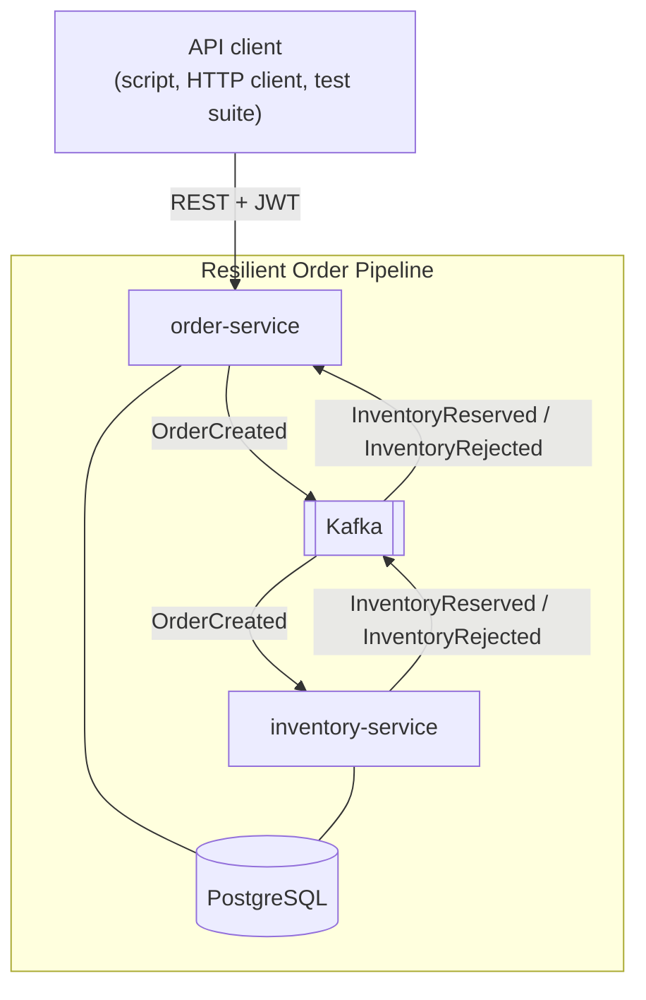

The only external actor is the API client. There are no third-party systems: tokens are self-issued.

### 3.2 Composition

- **ID:** DV-002 · **Title:** Containers · **Viewpoint:** Composition

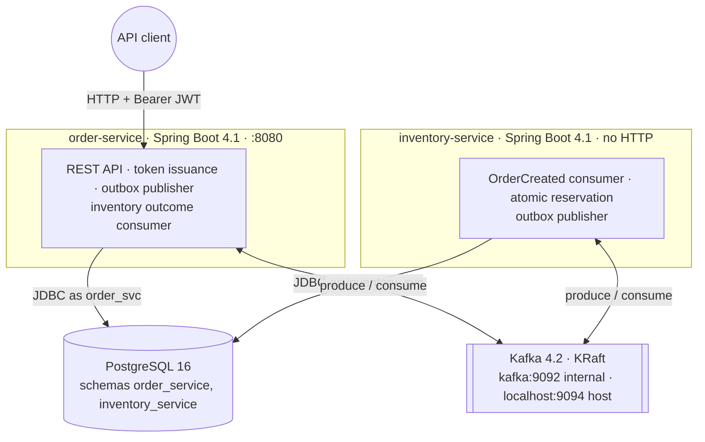

The services share no code (ADR-0016): the outbox publisher, the envelope mapper and the consumer
failure policy are deliberately duplicated and kept identical apart from their package.

### 3.3 Logical

- **ID:** DV-003 · **Title:** Domain and ports — order-service · **Viewpoint:** Logical

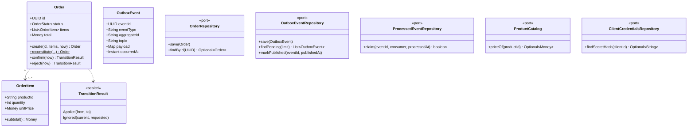

`Order.create` is the only way to build a new order and enforces BR-001, BR-002, BR-003 and BR-018.
`reconstitute` restores a persisted order without recalculating it. A transition on a terminal order
returns `Ignored` instead of throwing (BR-014). The domain has **no** `EventPublisher` port: use cases
only write to the outbox, and publishing is an adapter concern. Application services:
`CreateOrderService`, `GetOrderService` and `ApplyInventoryOutcomeService`.

- **ID:** DV-004 · **Title:** Domain and ports — inventory-service · **Viewpoint:** Logical

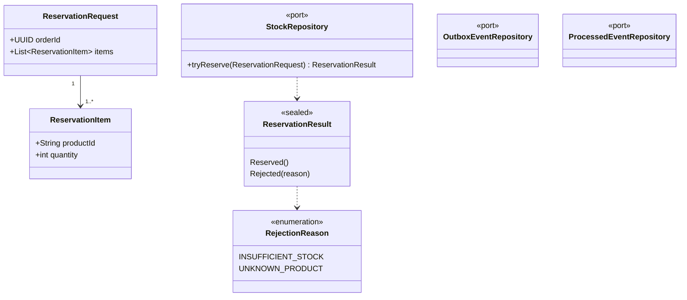

There is no stock entity in memory: a load-modify-save model is exactly what oversells under
concurrency. The domain holds values and one port that promises atomicity; the database provides it
(ADR-0010). A rejection is a result, never an exception. The outbox and processed-event ports are the
same as in order-service (ADR-0016). Application service: `ReserveInventoryService`.

### 3.4 Dependency

- **ID:** DV-005 · **Title:** Allowed dependency directions · **Viewpoint:** Dependency

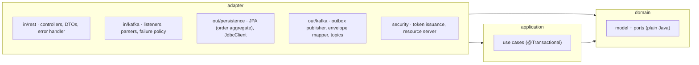

Dependencies point inwards only. `ArchitectureTest` in each service fails the build if `domain`
imports Spring, `jakarta.persistence`, Kafka or Jackson, if `domain` depends on `application` or
`adapter`, or if `application` depends on `adapter` (REQ-MAINT-001, ADR-0006).

### 3.5 Information

- **ID:** DV-006 · **Title:** Data model per schema · **Viewpoint:** Information

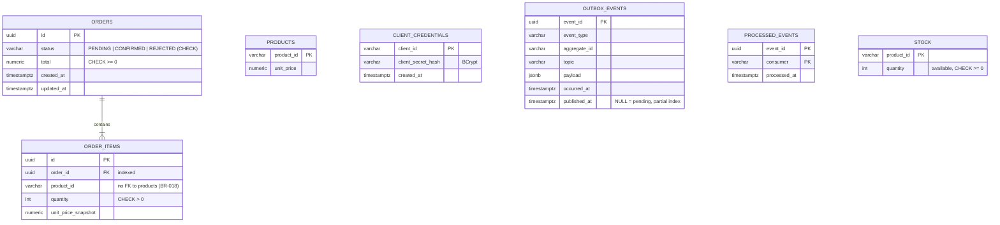

- `order_service` schema: `orders`, `order_items`, `products`, `client_credentials`, `outbox_events`,
  `processed_events`. Owner role `order_svc`.
- `inventory_service` schema: `stock`, `outbox_events`, `processed_events`. Owner role `inventory_svc`.
- Neither role has any privilege on the other schema or on `public`; each role's `search_path` is its
  own schema (ADR-0002, ADR-0015).
- `order_items.product_id` has no foreign key to `products` on purpose: the price is a snapshot and
  must outlive catalog changes (BR-018).
- Migrations (Flyway, run with the service role): order-service V1 technical tables, V2 business
  tables, V3 product seed, V4 client credentials (a Java migration registered as a Spring bean, which
  hashes the secret with BCrypt); inventory-service V1 technical tables, V2 stock, V3 stock seed.

### 3.6 Interface

- **ID:** DV-007 · **Title:** REST API — order-service · **Viewpoint:** Interface

| Endpoint | Auth | Request | Success | Errors |
|---|---|---|---|---|
| `POST /auth/token` | none | `{ "clientId", "clientSecret" }` | `200 { "accessToken", "tokenType": "Bearer", "expiresIn": 1800 }` | `400`, `401` |
| `POST /api/v1/orders` | Bearer | `{ "items": [{ "productId", "quantity" }] }` | `201 { "orderId", "status": "PENDING" }` + `Location` | `400` with `errors[]`, `401`, `422` |
| `GET /api/v1/orders/{id}` | Bearer | — | `200 { "orderId", "status", "items", "total" }` | `400`, `401`, `404` |

Every error is an RFC 9457 `ProblemDetail`: `400` for malformed requests (Bean Validation, unreadable
JSON, invalid id), `401` for missing or invalid credentials (with `WWW-Authenticate: Bearer`), `404`
for unknown orders, `422` for products outside the catalog, and a generic `500` that never exposes
internal details. Clients never send prices.

- **ID:** DV-008 · **Title:** Event contracts · **Viewpoint:** Interface

| Topic | Producer | Consumer group | Event |
|---|---|---|---|
| `order.created` | order-service | `inventory-service` | `OrderCreated { orderId, items[{ productId, quantity }] }` |
| `inventory.reserved` | inventory-service | `order-service` | `InventoryReserved { orderId }` |
| `inventory.rejected` | inventory-service | `order-service` | `InventoryRejected { orderId, reason }` |
| `<topic>.DLT` | consumer error handlers | — (inspection) | the original record, unchanged |

All events share the envelope `{ eventId, eventType, occurredAt, aggregateId, payload }`, are
serialized as JSON strings, and are keyed by the order id. Delivery is at-least-once: consumers
deduplicate by `eventId`. The full contracts, with examples taken from real messages, are in
[`events.md`](events.md), which is their single source.

### 3.7 Interaction

- **ID:** DV-009 · **Title:** Happy path — creation to confirmation · **Viewpoint:** Interaction

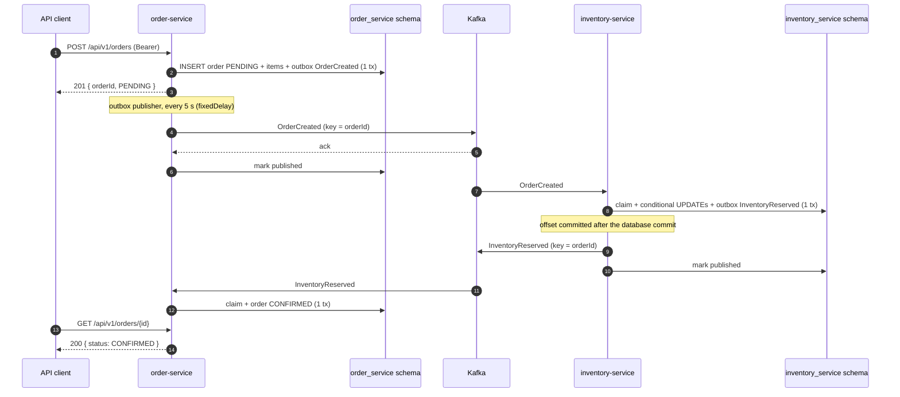

Neither service ever writes to the database and to Kafka in the same step: each state change and its
outgoing event commit together, and publishing happens afterwards (ADR-0001, ADR-0013).

- **ID:** DV-010 · **Title:** Failure path — Kafka unavailable · **Viewpoint:** Interaction

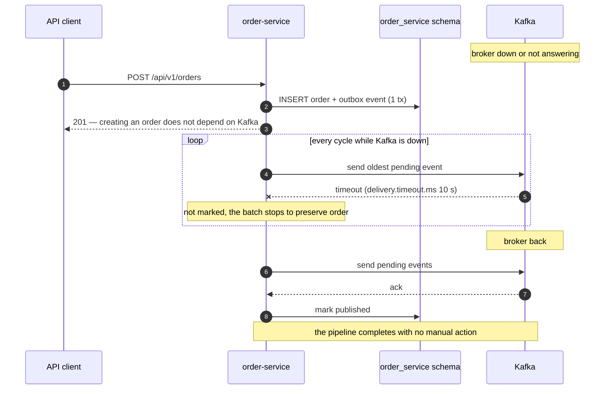

A timed-out send is ambiguous: the broker may still have written the record. The publisher, which did
not mark it, sends it again, and the consumer absorbs the duplicate by its `eventId` (DV-011). Verified
by `OutboxKafkaOutageIT` and, end to end, by `KafkaOutageSystemIT`.

- **ID:** DV-011 · **Title:** Duplicate delivery · **Viewpoint:** Interaction

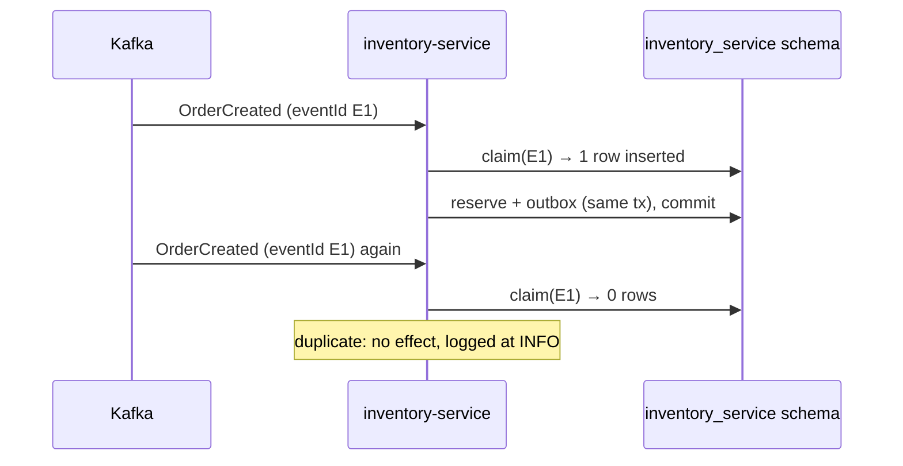

A concurrent duplicate waits on the primary key of the first, uncommitted claim, then inserts nothing.
The same mechanism protects order-service, where it also separates expected duplicates (INFO) from
genuinely contradictory events (WARN).

- **ID:** DV-012 · **Title:** Retries and dead letter topic · **Viewpoint:** Interaction

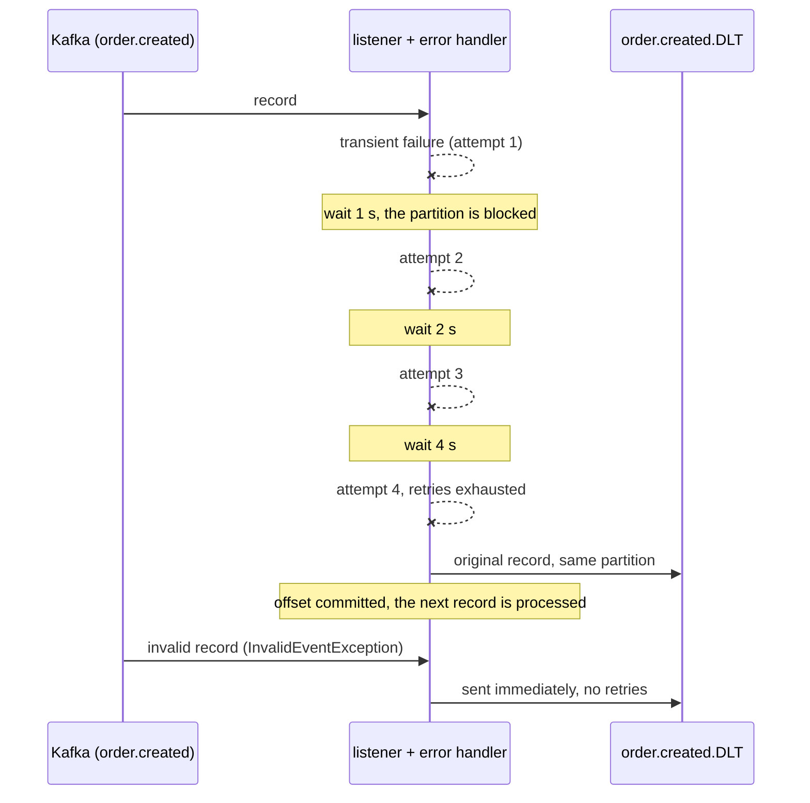

One delivery plus 3 retries with 1, 2 and 4 seconds of backoff (REQ-REL-001, ADR-0004). Retries block
the partition for about 7 seconds per failing record, a deliberate trade-off. Messages that violate
their contract are deterministic failures and go straight to the DLT.

- **ID:** DV-019 · **Title:** Outbox publisher · **Viewpoint:** Interaction

| Class | Responsibility |
|---|---|
| `OutboxPublisher` | One cycle: read up to 100 pending events oldest first, send each with key = `aggregateId`, wait up to 15 s for the acknowledgement, then mark it published. The first failure ends the cycle and leaves the event pending. Holds no database transaction while waiting for Kafka. |
| `OutboxSchedulingConfiguration` | Triggers a cycle with `fixedDelay` = `OUTBOX_POLLING_INTERVAL_MS` (default 5000), so slow cycles never overlap. Guarded by `outbox.publisher.scheduling-enabled`. |

| Producer setting | Value | Purpose |
|---|---|---|
| `acks` | `all` | The acknowledgement means the record is written |
| idempotence | client default | Removes duplicates caused by the client's own internal retries |
| `max.block.ms` | 5000 | Bounds the wait for metadata when the broker is unreachable |
| `request.timeout.ms` | 5000 | Bounds a single broker request |
| `delivery.timeout.ms` | 10000 | Bounds the whole send, including internal retries |

Delivery is **at-least-once**. A duplicate, always with the same `eventId`, comes from one of two
sources: the send succeeded but marking failed, or the send timed out ambiguously. Duplicates are
absorbed by the consumer's claim (DV-011, ADR-0011).

- **ID:** DV-020 · **Title:** Consumers and failure policy · **Viewpoint:** Interaction

| Aspect | Design |
|---|---|
| Listeners | inventory-service: one listener on `order.created`. order-service: one listener (a single container) on `inventory.reserved` and `inventory.rejected`, which derives the expected outcome from the topic. |
| Parsing | A dedicated inbound parser per service, separate from the outbound envelope mapper. Any contract violation (unreadable JSON, unexpected `eventType`, invalid ids, `aggregateId` different from `payload.orderId`, invalid items, unknown rejection reason) becomes a non-retryable `InvalidEventException`. Unknown fields are ignored for backward compatibility. |
| Offsets | `enable.auto.commit=false`, `AckMode.RECORD`: the offset is committed after the listener returns, that is, after the database commit. A crash in between causes a redelivery, never a loss. |
| New groups | `auto.offset.reset=earliest`, so events published before a consumer group first started are not skipped. |
| Dead letters | `DeadLetterPublishingRecoverer` with an explicit destination: `<topic>.DLT`, same partition as the original record. |
| Logs | The listener puts the record key (the order id) in the MDC before parsing, and the `eventId` after it, so even unparseable messages produce correlated logs. |

The failure policy and `InvalidEventException` are identical in both services (ADR-0016).

### 3.8 Algorithm

- **ID:** DV-013 · **Title:** Idempotent event handling · **Viewpoint:** Algorithm

```text
handle(event):                                             # one local transaction
    if not processedEvents.claim(event.eventId, CONSUMER):  # INSERT … ON CONFLICT DO NOTHING
        log INFO "duplicate"; return                        # 0 rows inserted: already processed
    effect = applyBusinessEffect(event)                     # a no-op when the transition is invalid
    if effect has an outgoing event:                        # inventory-service only
        outbox.save(outgoingEvent)
# the offset is committed after the commit (AckMode.RECORD)
```

The claim, the effect and the outgoing event commit together or not at all. If anything fails, the
claim is rolled back as well, so the redelivered event is processed from scratch instead of being
mistaken for a duplicate. Claiming first matters: claiming after the effect would let a redelivery
apply it twice before discovering the duplicate.

- **ID:** DV-014 · **Title:** Atomic stock reservation · **Viewpoint:** Algorithm

```text
tryReserve(request):                       # inside the caller's transaction, never its own
    savepoint = connection.setSavepoint()  # on the transaction's JDBC connection
    for item in request.items sorted by productId:      # fixed lock order: no deadlocks
        rows = UPDATE stock SET quantity = quantity - :qty
               WHERE product_id = :id AND quantity >= :qty
        if rows != 1:
            connection.rollback(savepoint)  # undo this reservation's decrements only
            reason = stock row exists ? INSUFFICIENT_STOCK : UNKNOWN_PRODUCT
            return Rejected(reason)          # the transaction stays usable
    release(savepoint)
    return Reserved
```

The check and the decrement are a single statement, so the row lock serializes concurrent
reservations and stock can never go negative; a `CHECK (quantity >= 0)` is a second barrier. The
savepoint lets a rejection be committed together with its claim and its `InventoryRejected` event.
It is taken on the connection of the current transaction (obtained through `DataSourceUtils`), so the
adapter works whether the transaction was opened declaratively or programmatically (ADR-0010).

### 3.9 State Dynamics

- **ID:** DV-015 · **Title:** Order state machine · **Viewpoint:** State Dynamics

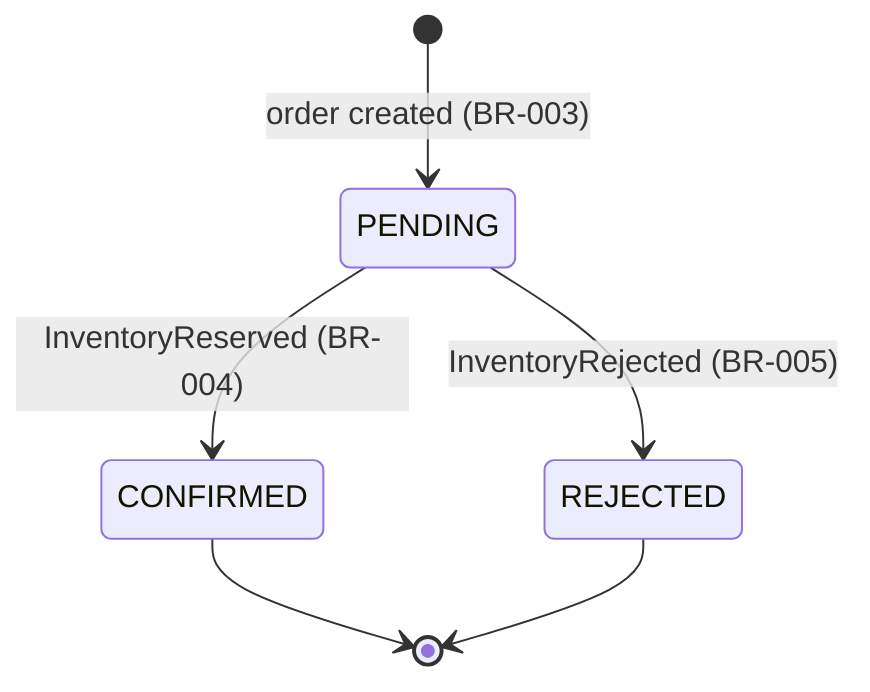

| Situation | Handling | Effect |
|---|---|---|
| Valid transition | Applied and saved | Status and `updated_at` change |
| Event on a terminal order | `Ignored`, logged at WARN | Nothing changes, `updated_at` included (BR-014, BR-017) |
| Duplicate event | Claim fails, logged at INFO | Nothing changes |
| Unknown order | Logged at WARN | The event is recorded as processed (REQ-FUNC-019) |

None of these is an error, so none is retried or dead-lettered. An order may stay `PENDING` while its
events are in flight (BR-011), or indefinitely if its event ends up in a DLT (a known limitation).

### 3.10 Concurrency

- **ID:** DV-016 · **Title:** Concurrency guarantees · **Viewpoint:** Concurrency

- **One publisher per service.** Each service runs one instance and its scheduler never overlaps
  itself (`fixedDelay`), so the outbox needs no row locking (ADR-0001). Running several instances
  would require `FOR UPDATE SKIP LOCKED` or change data capture. For the same reason the publisher is
  not scheduled in integration tests, where Spring keeps several test contexts alive at once: tests
  invoke it explicitly.
- **Stock.** Concurrent reservations of the same product are serialized by the row lock of the
  conditional `UPDATE`; a fixed lock order prevents deadlocks (DV-014).
- **Duplicates.** A concurrent duplicate claim waits for the first transaction and then inserts no
  row (DV-011).
- **Per-order ordering.** All events of an order share its key, hence a partition, and are processed
  serially. During a backoff the partition is blocked, so no record is processed twice in parallel.

### 3.11 Patterns

- **ID:** DV-017 · **Title:** Applied patterns · **Viewpoint:** Patterns

| Pattern | Where | Decision |
|---|---|---|
| Transactional Outbox with polling publisher | Both services | ADR-0001, ADR-0013 |
| Idempotent Consumer | Both consumers (`processed_events`) | ADR-0011 |
| Dead Letter Channel | Both consumers | ADR-0004 |
| Ports and Adapters (lightweight hexagonal) | Both services | ADR-0006 |
| Conditional atomic update with savepoint | inventory-service | ADR-0010 |
| Database-enforced data ownership | PostgreSQL roles and schemas | ADR-0002, ADR-0015 |

### 3.12 Deployment

- **ID:** DV-018 · **Title:** Docker Compose topology · **Viewpoint:** Deployment

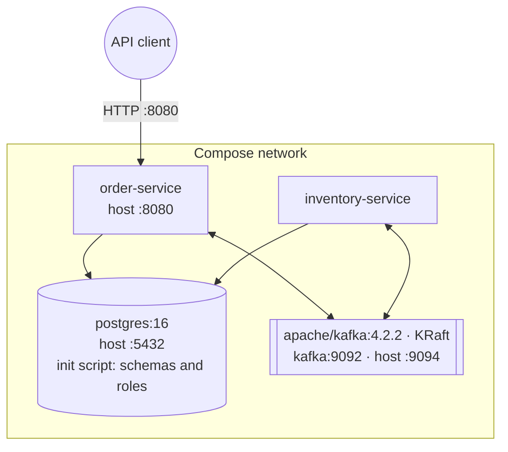

- A single `docker compose up --build` builds both images (multi-stage, so no JDK is needed on the
  host) and starts all four containers (REQ-INST-001).
- PostgreSQL and Kafka have healthchecks; the services start only when both are healthy and restart
  on failure.
- The services run as a non-root user.
- Topics are declared by the services at startup; broker-side auto-creation is disabled (ADR-0012).
- Logs are JSON on standard output, with `orderId` and `eventId` as fields (ADR-0008).

## 4. Decisions

The 18 decisions below are recorded in [`adr/`](adr/), each with its context, the options considered,
the consequences accepted and the tests that confirm it. This section only indexes them.

| ADR | Decision |
|---|---|
| 0001 | Outbox published by an embedded polling publisher: ack, then mark; at-least-once |
| 0002 | One schema and one role per service in a single PostgreSQL instance |
| 0003 | Partition key = aggregate id (the order id) |
| 0004 | `DefaultErrorHandler` with 1/2/4 s backoff, then a DLT; invalid messages are not retried; string values |
| 0005 | Self-issued HS256 tokens (`NimbusJwtEncoder`), validated by the Spring Security resource server |
| 0006 | Lightweight hexagonal architecture |
| 0007 | Kafka in KRaft mode, one node |
| 0008 | Spring Boot structured logging (JSON) with MDC |
| 0009 | Flyway migrations per service; seeds as migrations |
| 0010 | Stock reserved with a conditional `UPDATE` in a fixed order; rejection rolls back to a savepoint |
| 0011 | Claim, effect and outbox in one local transaction; offset committed afterwards |
| 0012 | 3 partitions, replication factor 1, topics declared at startup |
| 0013 | An outbox in inventory-service too |
| 0014 | A read-only product catalog; clients never send prices |
| 0015 | Each role owns its schema; Flyway runs with that role |
| 0016 | Independent services without a shared module; deliberate, verified duplication |
| 0017 | Java 21, Spring Boot 4.1, Kafka 4.x |
| 0018 | JPA only for the order aggregate; `JdbcClient` for technical tables and stock |

## 5. Security

- **Authentication.** `POST /auth/token` exchanges client credentials for an HS256 token valid for
  30 minutes. It is not OAuth2. Secrets are stored only as BCrypt hashes.
- **No client enumeration.** An unknown client and a wrong secret receive byte-identical `401`
  responses, and an unknown client is checked against a dummy hash so both paths take the same time.
- **Validation without clock skew.** The issuer and the validator are the same process, so an expired
  token is rejected as soon as it expires.
- **Deny by default.** Every request requires a valid token except `POST /auth/token` (and error
  forwards). Authentication failures return a `ProblemDetail` with `WWW-Authenticate: Bearer` and never
  reveal the reason.
- **Stateless.** No session and no cookies; CSRF protection is therefore unnecessary and disabled.
- **Secrets.** All secrets come from environment variables; the signing key is validated at startup
  (at least 32 bytes) and error messages name variables, never values. No token, secret or password
  is ever logged, which a system test verifies on the real container output.
- **Data access.** Each service connects with a role limited to its own schema; neither connects as a
  superuser.
- **Containers.** The services run as a non-root user.
- **Not in scope:** HTTPS, rate limiting, refresh tokens, key rotation.

## 6. Appendixes

### Appendix A — Configuration

Every setting comes from environment variables (REQ-INST-001). Docker Compose reads them from `.env`
(copied from `.env.example`) and refuses to start if a required one is missing.

| Variable | Used by | Required | Purpose |
|---|---|---|---|
| `POSTGRES_PASSWORD` | postgres | yes | Superuser password, used only by the init script that creates the service roles (ADR-0015) |
| `ORDER_DB_PASSWORD` | postgres, order-service | yes | Password of the `order_svc` role |
| `INVENTORY_DB_PASSWORD` | postgres, inventory-service | yes | Password of the `inventory_svc` role |
| `SEED_CLIENT_ID` | order-service | yes | API client seeded by a Java Flyway migration (ADR-0009) |
| `SEED_CLIENT_SECRET` | order-service | yes | Its secret; only the BCrypt hash is stored |
| `JWT_SIGNING_SECRET` | order-service | yes | HS256 signing key, at least 32 bytes, validated at startup |
| `OUTBOX_POLLING_INTERVAL_MS` | both services | no (5000) | Outbox publisher interval |

`DB_URL`, `DB_SCHEMA`, `DB_USER`, `DB_PASSWORD` and `KAFKA_BOOTSTRAP_SERVERS` are set by
`docker-compose.yml` and need no configuration. `DB_URL` is the same for both services: the schema
comes from each role's `search_path`.

### Appendix B — Traceability (SRS → design → decisions)

| Requirement | Design views | ADRs |
|---|---|---|
| REQ-FUNC-001..006 | DV-003, DV-006, DV-007, DV-009 | ADR-0001, ADR-0014 |
| REQ-FUNC-007..009, REQ-SEC-001/002 | DV-007, Section 5 | ADR-0005 |
| REQ-FUNC-010/011 | DV-009, DV-010, DV-016, DV-019 | ADR-0001, ADR-0003 |
| REQ-FUNC-012/013 | DV-004, DV-014 | ADR-0010 |
| REQ-FUNC-014/015/019 | DV-009, DV-015 | ADR-0011 |
| REQ-FUNC-016, REQ-FUNC-020 | DV-011, DV-013 | ADR-0011, ADR-0013 |
| REQ-FUNC-017 | DV-006 | ADR-0009 |
| REQ-FUNC-018 | DV-008, DV-018 | ADR-0012 |
| REQ-REL-001 | DV-012, DV-020 | ADR-0004 |
| REQ-OBS-001 | DV-018, DV-020 | ADR-0008 |
| REQ-INST-001, REQ-PORT-001 | DV-018, Appendix A | ADR-0007, ADR-0009 |
| REQ-MAINT-001 | DV-005 | ADR-0006 |
| REQ-MAINT-002 | DV-008 | — |

### Appendix C — Verification

Each design claim above is verified by an automated test. The mapping from behaviour to test is the
[Evidence](../README.md#evidence) table of the README. Two design choices shape the tests themselves:

- Integration tests use the same environment variables as Docker Compose and connect with the service
  roles; the outbox publisher and the Kafka listeners do not start on their own and are driven
  explicitly, because several cached test contexts would otherwise compete for the same tables and
  consumer groups.
- System tests run the real `docker-compose.yml` with images built from source, and break it on
  purpose: a paused broker, a consumer killed with SIGKILL, logs read from the containers.
